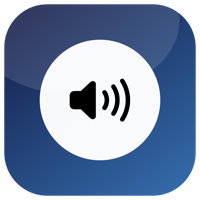

<p align="center">
  
</p>

<h1 align="center">VSLight</h1>

<p align="center">macOS 27을 위한 네이티브 볼륨 컨트롤. 소수점 단위 조절, 프리셋 단축키, 출력 장치 전환을 메뉴 바에서 처리합니다.</p>

<p align="center">
  <a href="https://github.com/B-HS/vslight/releases/latest"><b>최신 릴리스 다운로드</b></a>
</p>

## 기능

- **소수점 볼륨** — 슬라이더와 퍼센트 직접 입력. 현재 퍼센트를 클릭하면 바로 수정할 수 있습니다.
- **프리셋과 전역 단축키** — 설정에서 만든 프리셋을 Carbon 전역 단축키로 즉시 적용합니다. 기본 프리셋은 두지 않습니다.
- **출력 장치 전환** — 메뉴 바 창 상단에서 현재 장치를 확인하고 다른 출력 장치로 바로 바꿉니다.
- **최신 macOS UI** — Liquid Glass, macOS 27 `reorderable()`, Swift 6 strict concurrency.
- **안정적인 상태 감지** — 절전/깨우기, 세션 활성화, CoreAudio 서비스 재시작, 장치 변경을 감지해 다시 동기화합니다.
- **로그인 시 실행** — 시스템 설정의 로그인 항목 승인 상태를 표시하고, 필요하면 승인 화면을 엽니다.
- **앱별 볼륨 안내** — 현재 오디오를 재생하는 앱 목록을 보여주고, 가상 드라이버가 필요한 이유를 설명합니다.

서드파티 런타임이나 라이브러리를 사용하지 않습니다. SwiftUI, CoreAudio, Carbon 단축키 API만 사용합니다.

## 요구사항

- macOS 27.0 이상
- Xcode 27.2 이상 (소스 빌드)
- XcodeGen 2.45 이상 (`brew install xcodegen`)

## 설치

릴리스 ZIP을 받아 `VSLight.app`을 `/Applications`로 옮깁니다.

Developer ID 서명과 공증이 없는 빌드는 첫 실행 시 우클릭 > 열기로 실행해야 합니다. 로그인 시 자동 실행은 앱이 `/Applications`에 있을 때 안정적으로 동작합니다.

## 사용

1. 메뉴 바의 스피커 아이콘을 클릭합니다.
2. 상단에서 출력 장치를 선택합니다.
3. 큰 퍼센트 숫자를 클릭해 직접 입력하거나 슬라이더를 움직입니다.
4. 설정의 프리셋 탭에서 프리셋을 만들고 단축키를 기록합니다.
5. 설정의 일반 탭에서 로그인 시 실행과 승인 상태를 관리합니다.

단축키를 기록할 때는 최소 하나의 보조 키(Command, Option, Control, Shift)가 필요합니다. Escape로 기록을 취소합니다. 다른 앱이 이미 사용하는 조합은 등록되지 않고 경고가 표시됩니다.

## 빌드

```bash
xcodegen generate
xcodebuild -project VSLight.xcodeproj -scheme VSLight -configuration Debug \
  -derivedDataPath build build
open build/Build/Products/Debug/VSLight.app
```

Xcode에서 열 때는 `VSLight.xcodeproj`를 사용합니다. `project.yml`을 수정하면 `xcodegen generate`를 다시 실행합니다.

## 테스트

```bash
xcodebuild -project VSLight.xcodeproj -scheme VSLight \
  -destination 'platform=macOS' test
bash Scripts/check-version.sh
swift Scripts/verify-audio.swift
```

`AudioDeviceTests`는 임시 집계 장치를 만들어 다중 출력 장치 열거를 검증합니다. 테스트가 끝나면 장치를 제거합니다.

`Scripts/probe-volume.swift`는 현재 볼륨을 0.1373으로 설정하고 되읽어 소수점 반영을 확인한 뒤 원래 값으로 복원합니다. 오디오 출력이 잠깐 바뀔 수 있습니다.

## 아이콘

```bash
swift Scripts/generate-icon.swift
```

`Resources/icon-1024.png`를 만들고 `Sources/Resources/Assets.xcassets/AppIcon.appiconset`의 모든 크기를 생성합니다.

## 버전 정책

버전과 빌드 번호에 숫자 4를 사용하지 않습니다.

```text
0.1.0 -> 0.2.0 -> 0.3.0 -> 0.5.0 -> 0.6.0 -> 0.7.0 -> 0.8.0 -> 0.9.0 -> 0.10.0
```

`bash Scripts/check-version.sh`가 위반을 차단합니다. 자세한 내용은 [docs/VERSIONING.md](docs/VERSIONING.md)를 참고합니다.

## CI와 릴리스

- `.github/workflows/ci.yml` — 빌드와 테스트. macOS 27 러너가 없으면 self-hosted Mac으로 바꿉니다.
- `.github/workflows/release.yml` — 버전 계산, 테스트, Release 빌드, 선택적 서명/공증, ZIP과 SHA256, draft GitHub Release 생성.

두 워크플로는 `MACOS_RUNNER` 저장소 변수를 읽습니다. 값이 없으면 `macos-27`을 사용합니다. 호스팅 이미지가 없으면 저장소 Settings > Variables에서 `MACOS_RUNNER`를 `self-hosted` 또는 사용 가능한 러너 라벨로 지정합니다.

릴리스 워크플로는 다음 시크릿을 사용합니다. 값이 없으면 ad-hoc 서명으로 진행하고 공증을 건너뜁니다.

| 시크릿 | 용도 |
| --- | --- |
| `MACOS_CERTIFICATE` | Developer ID Application 인증서 (base64 p12) |
| `MACOS_CERTIFICATE_PASSWORD` | 인증서 비밀번호 |
| `APPLE_ID` | 공증용 Apple ID |
| `APPLE_TEAM_ID` | 팀 ID |
| `APPLE_APP_PASSWORD` | 앱 전용 비밀번호 |

릴리스는 draft로 생성되므로 테스트 후 직접 공개합니다.

## 알려진 제한

- 앱별 볼륨은 지원하지 않습니다. macOS 공개 API에 프로세스 볼륨 프로퍼티가 없어 가상 HAL 오디오 드라이버가 필요합니다. [docs/PER_APP_AUDIO.md](docs/PER_APP_AUDIO.md)
- App Sandbox를 사용하지 않습니다. v0.1은 Developer ID 직접 배포를 전제로 합니다.
- 자동 업데이트는 포함하지 않습니다.

## 구조

```text
Sources/
  App/                    앱 진입점, 루트 모델, 메뉴 바 라벨
  Core/Audio/             CoreAudio 장치/볼륨/프로세스 계층
  Core/Hotkeys/           Carbon 전역 단축키
  Core/Settings/          설정과 프리셋 저장
  Core/System/            절전/깨우기/세션 감지
  Core/Version/           숫자 4 금지 버전 정책
  Features/Volume/        메뉴 바 볼륨 UI
  Features/Output/        출력 장치 메뉴
  Features/Presets/       프리셋 칩
  Features/Apps/          앱별 볼륨 안내 화면
  Features/Settings/      설정 창
Tests/                    단위/통합 테스트
Scripts/                  버전 검사, 아이콘 생성, CoreAudio 진단
docs/                     아키텍처, 버전 정책, 앱별 볼륨 계획, 작업 기록
```
